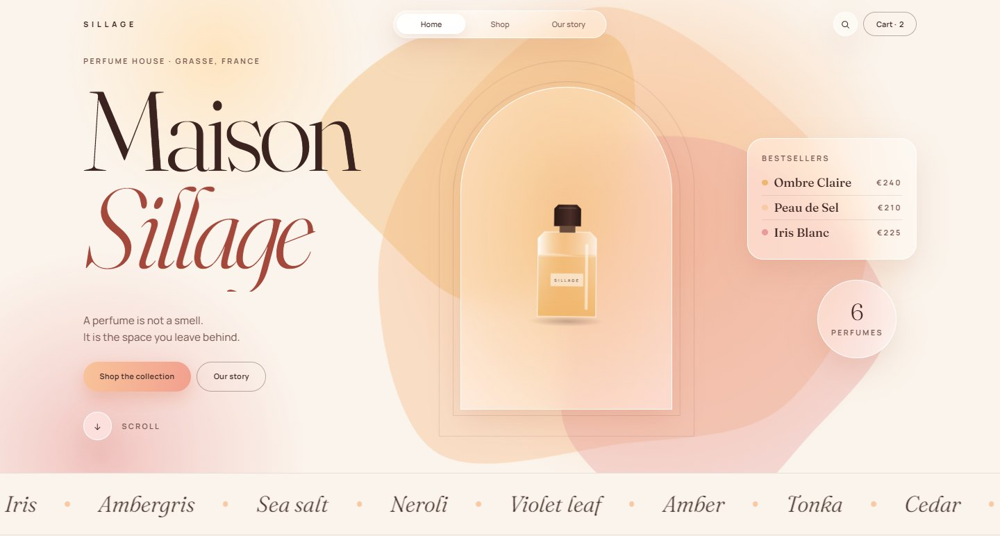
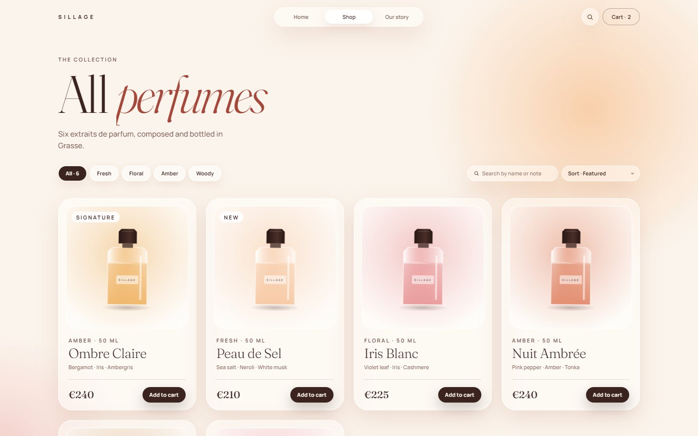
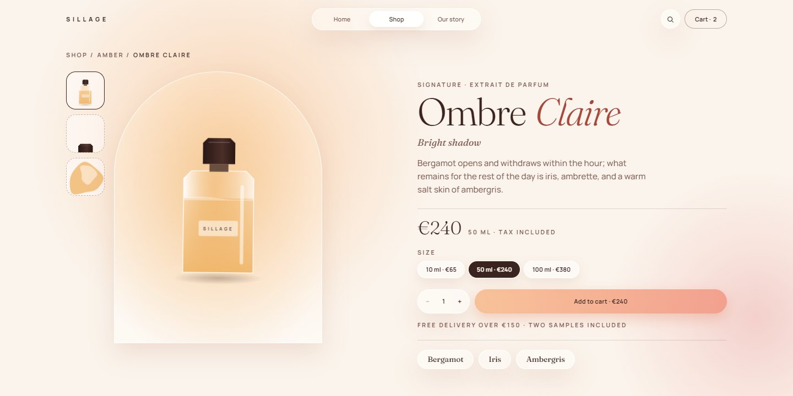
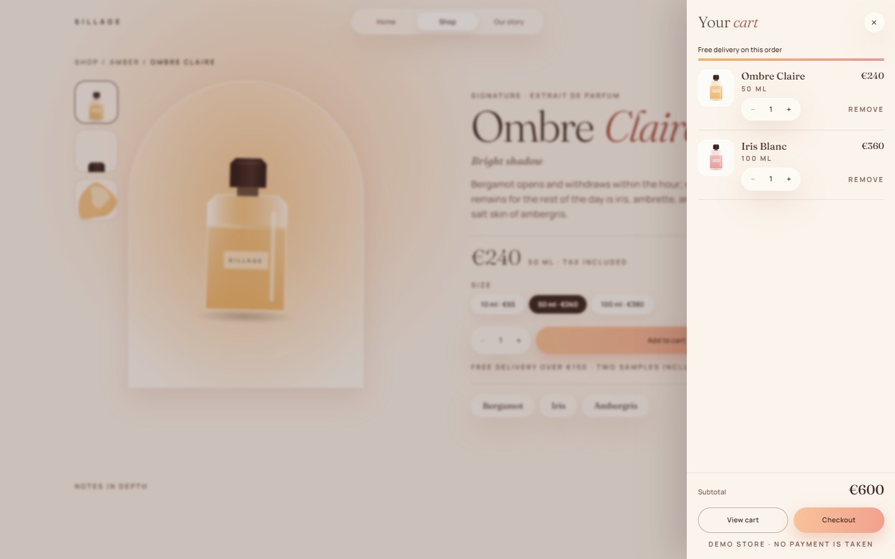
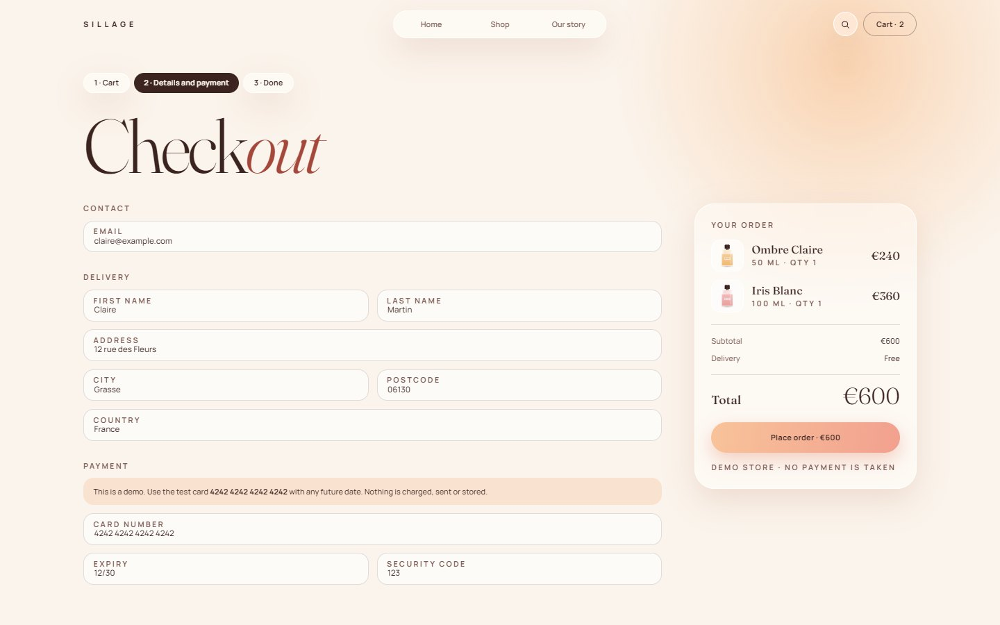
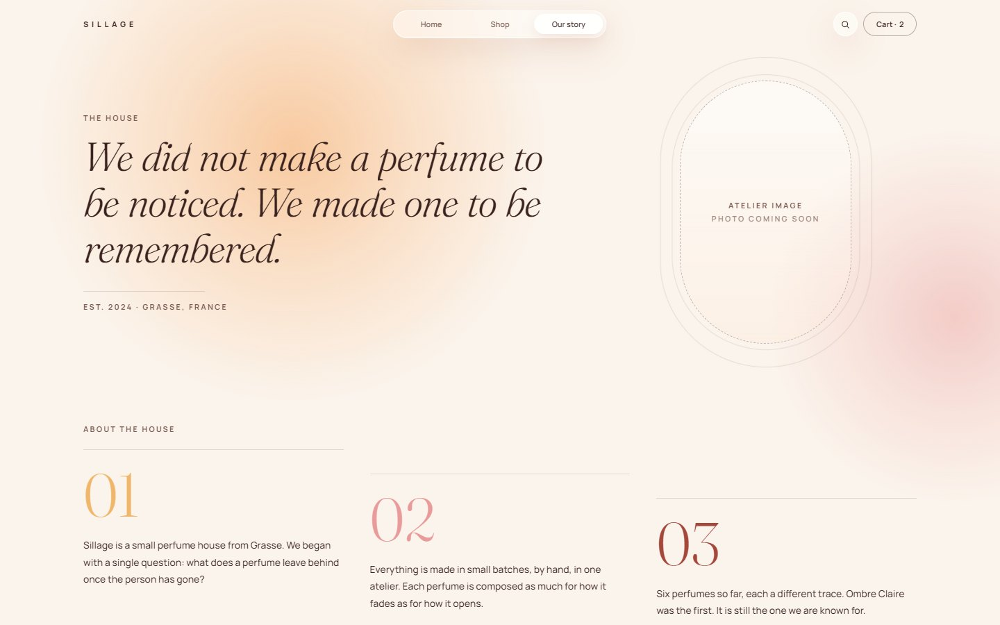
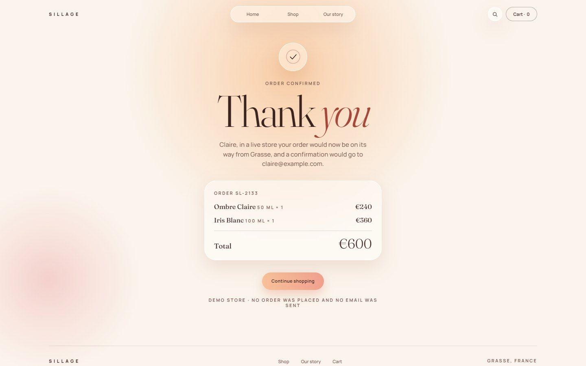
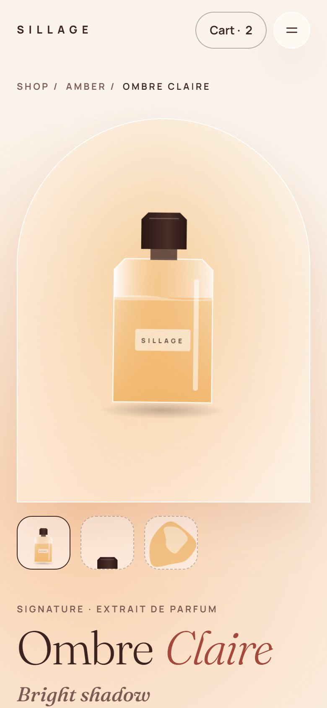
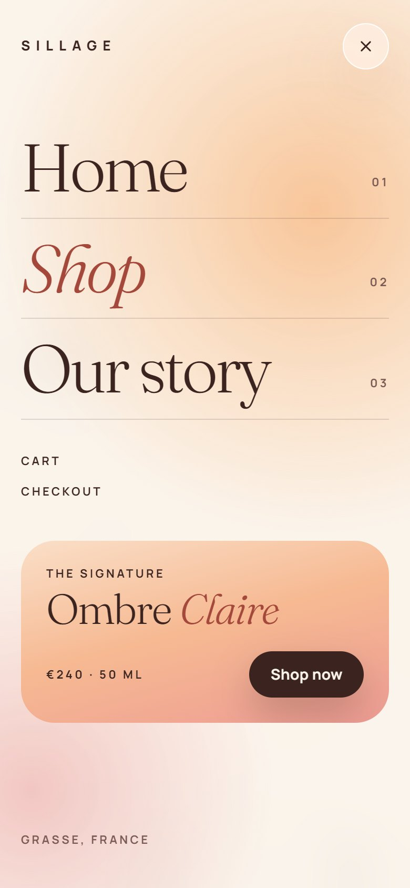
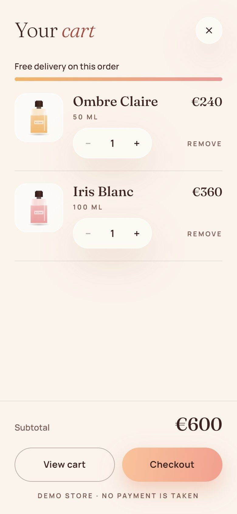

<p align="center">
  
</p>

# Sillage

A demo online store for Sillage, a small perfume house from Grasse. It was built to show a store owner what their shop could look and feel like before they decide to use it.

> **Live:** _not deployed yet_ · **Status:** demo. The cart and checkout work in the browser, but no payment is taken and nothing is sent or stored on a server.

**Built with** React 19, TypeScript, Vite, Tailwind CSS v4, Motion, Zustand, React Hook Form + Zod, Vitest and Playwright.

## Screenshots

### Desktop

<table>
  <tr>
    <td width="50%"></td>
    <td width="50%"></td>
  </tr>
  <tr>
    <td align="center"><b>Shop</b>: filter by family, search by name or note, sort</td>
    <td align="center"><b>Product</b>: sizes, quantity and a price that updates</td>
  </tr>
  <tr>
    <td></td>
    <td></td>
  </tr>
  <tr>
    <td align="center"><b>Cart drawer</b>: slides in from any page</td>
    <td align="center"><b>Checkout</b>: validated form, simulated payment</td>
  </tr>
  <tr>
    <td></td>
    <td></td>
  </tr>
  <tr>
    <td align="center"><b>Our story</b>: the house and how it works</td>
    <td align="center"><b>Order confirmed</b>: the end of the demo purchase</td>
  </tr>
</table>

[See the whole home page in one image →](docs/screenshots/desktop-home-full.jpg)

### Phone

<table>
  <tr>
    <td width="25%"></td>
    <td width="25%"></td>
    <td width="25%"></td>
    <td width="25%"></td>
  </tr>
  <tr>
    <td align="center">Home</td>
    <td align="center">Product</td>
    <td align="center">Menu</td>
    <td align="center">Cart</td>
  </tr>
</table>

## What it does

- **Browse:** a home page that introduces the house, a shop with family filters, search and sorting, and a page for each perfume with sizes, quantity, notes and a 24-hour wear timeline.
- **Buy (demo):** add to cart from any card or product page, a slide-in cart drawer, a cart page with quantities and two free samples, a validated checkout form, and an order confirmation.
- **Remember:** the cart is saved in the browser, so it survives a reload. Saved data is checked before use, and card details are never saved.
- **Move:** page transitions with a curtain wipe, headings that rise word by word, scroll reveals, a scroll progress line, a header that hides on scroll, 3D tilt on product cards, magnetic buttons, count-ups, a timeline that draws itself as you scroll, and drifting glows. Every animation respects the visitor's reduced-motion setting.

To try checkout, use the test card `4242 4242 4242 4242` with any future expiry date and any 3-digit code.

## Design

The look is called "Halo": warm cream, peach, rose and amber glows, frosted glass panels, arch shapes, with Fraunces for headings and Manrope for everything else. Every page was designed in Figma first, at desktop (1440 px) and phone (390 px) widths, and then built to match.

**Sized for real laptops.** A 1920 × 1080 laptop with Windows display scaling at 125% only shows about 1400 × 700 px of page, so a layout drawn at full size feels zoomed in there. From 1024 px wide upward, the root font size drops to 80/110 (about 73%). Every size is written in `rem`, so the whole desktop layout shrinks together, and text never goes below 11 px. Phones keep the full size. The wider space this frees up goes to a fourth product card per row from 1280 px up.

**Images are placeholders.** The bottles are a drawn illustration and the atelier photos are labelled empty frames, so the design can be judged before any photography exists.

## Stack, and why

| Tool | Why it is here |
|---|---|
| React 19 + TypeScript + Vite | Fast to build and to load. Builds to static files, so hosting is free. |
| React Router (data router) | Seven real pages, and shop filters kept in the URL so they can be shared. |
| Tailwind CSS v4 | The design exists at phone and desktop width. Responsive utilities handle both, and the "Halo" colours and fonts live as tokens in `src/styles/global.css`. |
| Motion (`motion/react`) | Page transitions, shared-element highlights and exit animations that CSS alone cannot do. Durations and easings all come from `src/lib/motion.ts`. |
| Zustand (with `persist`) | The cart is shared by the header, drawer, cart page and checkout, and has to survive a reload. |
| React Hook Form + Zod | The checkout form. One schema gives both the rules and the TypeScript type. |
| Vitest + Testing Library, Playwright | Unit tests for the cart maths and form rules, page tests, and end-to-end purchase tests at desktop and phone sizes. |

Product data sits in `src/data/products.ts` behind `src/data/productRepository.ts`. Pages only talk to the repository, so a real store could swap in an API without touching the pages.

## Getting started

Requires Node 22.12 or newer.

```bash
npm install
npm run dev            # http://localhost:5173
npm run test:run       # unit and page tests
npm run test:coverage  # the same, with a coverage report
npm run lint
npm run build          # type check + production build
npm run preview        # serve the production build
npm run e2e            # Playwright end-to-end tests (builds first)
```

Playwright needs its Chromium. Run `npx playwright install chromium` once, or point `PLAYWRIGHT_CHROMIUM_PATH` at a Chromium you already have.

## Quality

- **Tests:** 65 unit and page tests (cart maths, saved-cart checks, checkout rules, shop filters, every page) and Playwright end-to-end tests that buy a perfume from the home page to the confirmation, at desktop and phone sizes.
- **Accessibility:** one `h1` per page, real buttons and links, a visible focus ring, and dialogs (cart drawer, phone menu) that trap focus, close on Escape and give focus back. With reduced motion turned on, the page is complete straight away.
- **Privacy:** card details never reach the cart store, the browser's storage or the URL. Only the email and first name are used, to write the confirmation message.
- **Deploy headers:** `vercel.json` sends a strict Content Security Policy that blocks outside scripts, network calls and form posts, plus `nosniff`, a referrer policy and a permissions policy.
- **Smaller first load:** the checkout code is split out and only downloads when a visitor opens checkout.

## Project layout

```
src/
├── components/
│   ├── layout/     header, footer, mobile menu, page transitions
│   ├── motion/     reveal, split-text headings, magnetic, count-up
│   ├── product/    bottle illustration, product card, add-to-cart button
│   ├── sections/   page sections (hero, spotlight, timeline, ...)
│   └── ui/         buttons, option pills, quantity stepper, decorative layers
├── data/           products and the repository pages read from
├── features/       cart (logic, store, drawer), checkout rules, shop filters
├── lib/            config, money formatting, motion tokens
├── pages/          one component per route
└── routes.tsx      the route table, shared by the app and the tests
design/             Python generators for the Figma designs (not part of the app)
docs/screenshots/   the images in this README
e2e/                Playwright tests
```

## Placeholders to replace before this goes live

- **Catalogue:** only Ombre Claire (its notes and the €240 / 50 ml price) is real brand copy. The other five perfumes, all other prices, sizes and the discovery set are invented.
- **Store promises:** free delivery over €150, two samples per order and 30-day returns are placeholders in `src/components/sections/ServicesStrip.tsx` and `src/lib/config.ts`.
- **Copy:** the "Our story" paragraphs and the timeline hours are drafts.
- **Images:** bottles are an illustration, and the atelier photos are labelled empty frames. Real photography should replace both.
- **Payments:** checkout is simulated. A real store needs a payment provider and a server.
